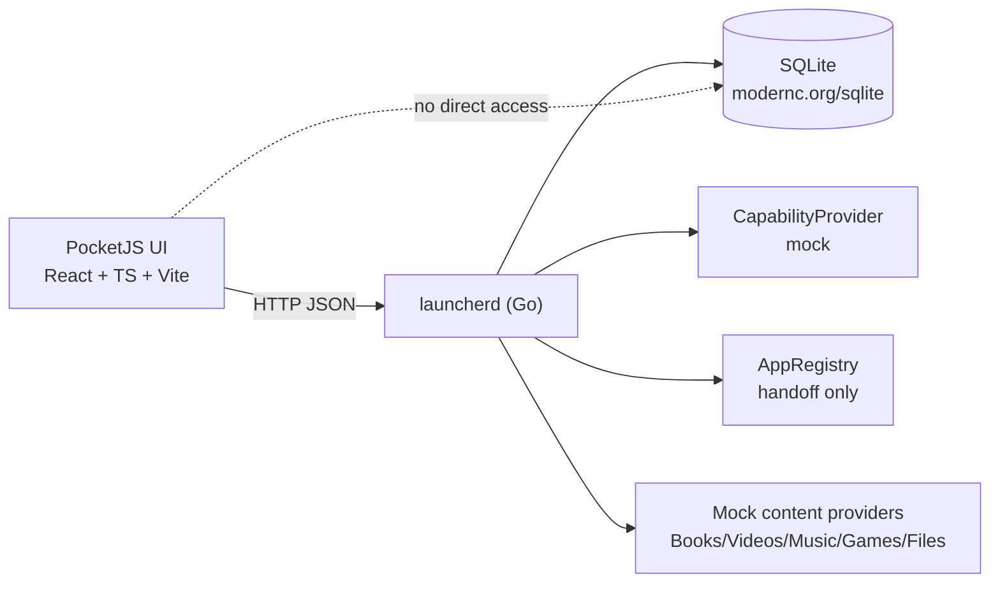

# Architecture

## Layers

The browser never opens SQLite, the filesystem, or system configuration. Every read and write goes through `launcherd`, which owns schema migrations and all persisted state. There is no Electron.

## Why a single service

The launcher is the first thing a handheld draws after boot, so a single binary keeps startup shallow: one process reads SQLite and serves both `/api/*` and (when `LAUNCHER_STATIC` is set) the built SPA. Frontend and backend never need separate origins in production.

## Capability layer

`CapabilityProvider` decides which widgets and quick settings exist. The mock baseline marks `touch` unavailable and every other capability available; `PUT /api/capabilities` overrides any of them so the UI can be exercised for devices without Wi-Fi, Bluetooth, battery, storage, notifications or a gamepad. `GET /api/home`, `/api/capabilities` and `/api/quick-settings` all read the same gating, so a hidden widget cannot reappear through a second endpoint.

Hardware is never inferred: capability values are mock overrides, and `source` is always `"mock"`.

## App registry and handoff

`AppRegistry` maps the seven Pocket apps (`reader`, `music`, `video`, `gamehub`, `files`, `settings`, `store`). It stores pinned order, favorites and recent use. It does not embed any app's internal pages.

`POST /api/apps/{id}/launch` is the only handoff:

- available app → `{available:true, launched:true}`; a recent-use row is recorded;
- missing app (`gamehub`, `store` in mock) → `{available:false, launched:false}` with full metadata, so the UI renders an unavailable state and keeps the item.

`launched` in mock mode means "handoff accepted by the mock registry", not that an external process was started. This distinction is deliberate and documented in [ROADMAP](ROADMAP.md).

## Profiles

Profiles change the home surface order, not only a label:

| profile | first surfaces |
|---|---|
| handheld | Continue → Downloads → Pinned → Recent |
| dap | Continue → Pinned → Collections → Recent |
| eink | Continue → Collections → Recent → Pinned |
| desktop | Pinned → Continue → Recent → Downloads |

`GET /api/home` returns the resolved `widgets` order; the frontend renders that order and falls back to the same table only if the list is malformed. E-Ink additionally selects high contrast and reduced motion in the UI.

## Mock providers

All fixtures live in `backend/launcherd/mockdata.go` and are deterministic. Every item carries `mock: true`, and every response includes a top-level `mock` flag. A future real provider must replace these fixtures behind the same JSON contract; the UI has no separate "real mode" code path.
